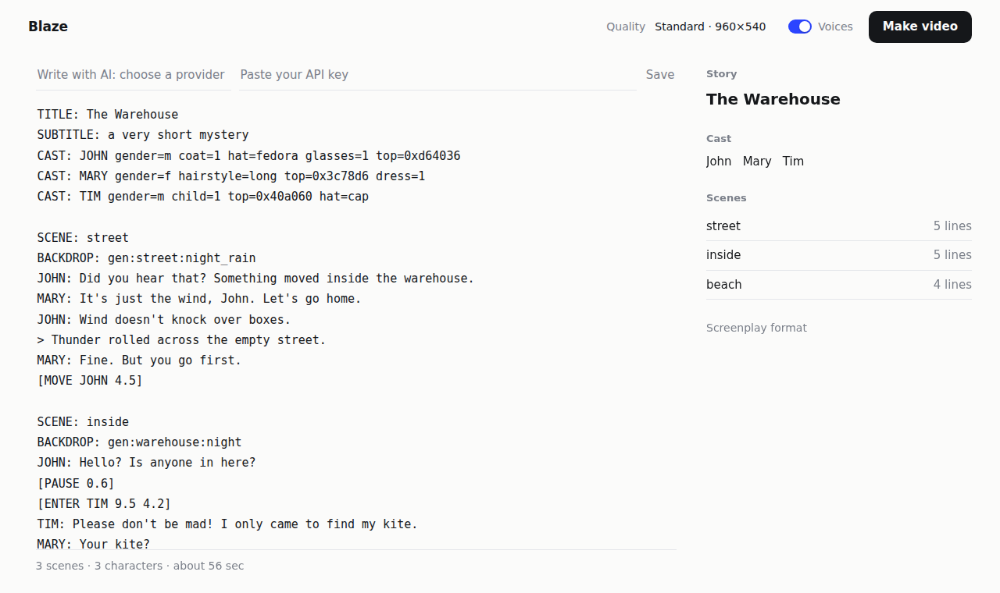
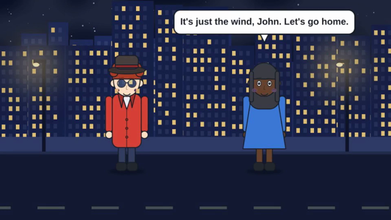
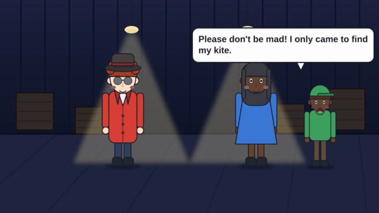
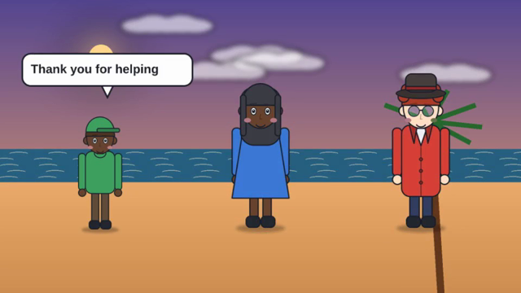

# Blaze

[](https://github.com/MrGrimJoe/blaze/actions/workflows/ci.yml)
[](https://github.com/MrGrimJoe/blaze/actions/workflows/build-blaze-installer.yml)
[](https://github.com/MrGrimJoe/blaze/actions/workflows/screenshots.yml)

**Write a story as plain text. Get an animated, voiced video.**

```
JOHN: Did you hear that?
MARY: It is just the wind.
[ENTER TIM 9.5 4.2]
TIM: Please don't be mad! I only came to find my kite.
```

Blaze turns a screenplay like this into an mp4 with characters, backdrops, speech bubbles, a voice for every character
and subtitles. It runs on your own computer, offline, with no account and no AI. If you want, an AI can write the
screenplay for you, but it never draws anything: **every frame is drawn by the [CDRCA](https://github.com/ISLAH-org/CDRCA)
animation engine from exact instructions**, so the same screenplay always gives the same video.



## What Blaze is

Blaze is a **screenplay-to-video compiler**, not a video generator. Nothing is invented at render time.

1. You write a screenplay in a small, strict format (lines of dialogue plus a few stage commands).
2. Blaze checks it and tells you the exact line that is wrong, if any.
3. It draws the characters and backdrops, records a voice for each line, and works out the timing.
4. It writes one plain, readable CDRCA script per scene and renders every frame with CDRCA's own renderer.
5. It joins the scenes, voices and subtitles into one mp4.

You can open and edit the generated CDRCA scripts and render again, so nothing is a black box.

## The language in one minute

A screenplay has two layers. The **shorthand** is what you normally write; the **core** is what it means. `python blaze.py expand`
prints the core, so you never have to guess what a line does (the second block is real output, not a sketch):

What you write (shorthand):

```
TITLE: The Lost Key
CAST: JOHN gender=m hat=fedora voice=espeak:en-gb+m3
CAST: MARY gender=f dress=1
DEFINE LOOK shout size=0.55 ink=0xc0141e

INT. STREET - NIGHT
BACKDROP: gen:street:night_rain
JOHN: Did you hear that?
MARY (look=shout): It is just the wind!
> Thunder rolled across the street.
[MOVE JOHN 3] [HOP MARY]
```

What it means (`python blaze.py expand story.txt`):

```
TITLE: The Lost Key
CAST: JOHN gender=m hat=fedora voice=espeak:en-gb+m3
CAST: MARY gender=f dress=1
DEFINE LOOK shout size=0.55 ink=0xc0141e

SCENE: STREET - NIGHT
BACKDROP: gen:street:night_rain
SPEAK JOHN "Did you hear that?"
SPEAK MARY "It is just the wind!" look=shout
NARRATE "Thunder rolled across the street."
MOVE JOHN 3
HOP MARY
```

The rules, all of them enforced before anything is drawn:

- **A character is `CAST: NAME key=value ...`**: a name, then `key=value` pairs. The old `CAST: ROBO = asset:robo` form is gone; write
  `CAST: ROBO asset=robo`. A speaker must be declared with `CAST:` or written in CAPITALS, so `Later that day: ...` is an error, not a new character.
- **Every value is exact.** Positions are numbers (`[MOVE JOHN 3]`, never `left`), looks are `key=value`, places and moods are fixed names
  (`gen:street:night_rain`). Anything else is an error that names the line and says what to write instead.
- **A typo is never a new thing.** `[MOV JOHN 3]` is `unknown command ... (did you mean MOVE?)`; `[MOVE JOHM 3]` is `'JOHM' is not a character`.
- **Brackets in speech stay speech** unless they are commands: `JOE: I put it in [the box]` is just text.

Every line type, key and error is in the [screenplay reference](docs/reference/screenplay.md).

## What it can do

| | |
|---|---|
| **Scenes and dialogue** | Any number of scenes, any number of speakers, a narrator, a title card with subtitle. Text is not always a speech box: define your own **looks** (`DEFINE LOOK shout size=0.55 ink=0xc0141e`), put text at a fixed place, or speak a line without drawing it. |
| **A strict, explicit language** | A small explicit core (`SPEAK`, `NARRATE`, `MOVE` ...) with the friendly `NAME: text` shorthand expanding into it (`blaze expand`). Misspelt names and commands are errors with a suggestion, never new characters. |
| **Staging** | Characters walk in (`ENTER`), walk to a spot (`MOVE`), hop (`HOP`), walk out (`EXIT`), and you can `PAUSE`. Positions are exact numbers. Characters never stand on each other. |
| **Characters** | Drawn for you from exact traits (`gender`, `hairstyle`, `top`, `coat`, `hat`, `glasses`, `child` ...), with a mouth that moves while they speak. Or bring your own PNG or Blender model. |
| **Backdrops** | 6 places (street, room, warehouse, forest, beach, office) in 9 moods (day, sunset, night, dim, rain, storm, snow, night_rain, night_snow), drawn for you. Or bring your own image or Blender scene. |
| **Voices** | A voice for every character: pick one per character (`CAST: JOHN voice=espeak:en-gb+m3 rate=140`, with espeak-ng, system voices or Piper) or let Blaze give each a stable one. Speech boxes reveal text in time with the voice. Or render silent. |
| **Subtitles** | An `.srt` file for every video. |
| **Output** | mp4 at the size and frame rate you choose (640x360 for quick drafts, 1920x1080 for the final). |
| **Editable** | Every video leaves a project folder with the generated CDRCA scripts, assets and audio. Change a number, run `blaze build`. |
| **A page and a command line** | `python blaze.py ui` opens a page with three modes (**Editor**, **Smart**, **Running**, see below): write, see it understood as you type, add your own characters, make, watch on a timeline, download. Or script it with `blaze make`. |
| **Blaze Studio** | A desktop window: describe a video loosely and it plans the shots, draws, renders and joins them. Includes an **offline demo** that needs no AI, no key and no GPU. |
| **Optional AI** | Describe a story and let your own Anthropic, Gemini or OpenAI account write the screenplay: one short scene, or a whole multi-scene story planned and checked step by step. No provider is chosen for you. |

## See it work

This is the bundled example, `tests/fixtures/sample_story.txt`, rendered by Blaze. Three scenes, three characters, voices on.

| Scene 1: street, night rain | Scene 2: inside the warehouse | Scene 3: the beach |
|---|---|---|
|  |  |  |

## Three modes

`python blaze.py ui` opens one page with three tabs. They share the same screenplay, so you can move between them at any time.

| Mode | For | What you get |
|---|---|---|
| **Editor** | writing code | Just the screenplay: line numbers, the line with the mistake marked in red and named at the bottom, Tab to indent. No side panel. |
| **Smart** | writing with help | The page above: the cast, scenes, warnings and a voice for each character update as you type; your own characters and backdrops live here; optional AI writer. |
| **Running** | watching the result | The finished video with a timeline under it: a row of scenes, a row per speaker with a block for every line, a playhead you can drag, a list of lines you can click, speed and zoom. A dot on the tab tells you a new video is ready. The last video comes back after a reload. |

**Your own characters.** In Smart, **Add character** takes a PNG with a transparent background, or a `.blend` model that Blender renders
for you (front view, with `talk` and `blink` shape keys driving the mouth and eyes). **+ mouth** adds an open-mouth picture to a
character you already have; **Use** writes `CAST: ROBO asset=robo` into the screenplay. A `CAST` line that names a character you have not
added is reported on its own line while you type. `.blend` files need [Blender](https://blender.org) installed; PNGs do not
([Tutorial 3](docs/tutorials/03-your-own-art.md)).

## Start in three minutes

**On Windows the easiest way is the installer**: run it and open **Blaze** from the Start menu. Python, Node.js, ffmpeg, the
browser and Windows voices are all inside it, and no administrator rights are needed. It is built by GitHub Actions
(**Actions → Build Blaze Installer → a run → Artifacts → `blaze-installer`**, or a GitHub Release for a `v*` tag). Only a build that is
full size (about 280 MB) **and** whose installed copy then made a video on a clean machine is published under that name; a build that
failed either check leaves only `blaze-installer-unverified`, which you should not use. Details: [docs/installer.md](docs/installer.md).

**From source** (any system) you need **Python 3.9+**, **Node.js** and **ffmpeg**. Voices need **espeak-ng** (or `pip install pyttsx3` for the system voices on Windows and macOS), or [Piper](docs/tutorials/04-voices-timing-subtitles.md) for natural offline voices; `python blaze.py voices` shows what is installed.

```
pip install -r requirements.txt
python blaze.py setup        # installs the renderer's headless browser (one time)
python blaze.py doctor       # checks that everything is in place
python blaze.py ui           # opens the page in your browser
```

In the page, press **start from an example**, then **Make video**. Pick **Draft** quality first: it is the fastest, and
a weak computer will thank you. The full walkthrough is in [Tutorial 1](docs/tutorials/01-your-first-video.md).

Prefer the command line?

```
python blaze.py make story.txt -o story.mp4 --res 960x540 --fps 20
```

## Learn it

| Tutorial | You will |
|---|---|
| [1. Your first video](docs/tutorials/01-your-first-video.md) | Install, open the page, make and watch a video. |
| [2. Writing a screenplay](docs/tutorials/02-writing-a-screenplay.md) | Learn every line type, with examples and the errors you will meet. |
| [3. Your own characters and backgrounds](docs/tutorials/03-your-own-art.md) | Use your own PNG, JPG or Blender models. |
| [4. Voices, timing and subtitles](docs/tutorials/04-voices-timing-subtitles.md) | Choose voices, speed, quality and understand how long things take. |
| [5. Writing with AI](docs/tutorials/05-writing-with-ai.md) | Choose a provider, write a scene or a whole story, and know what it costs and checks. |
| [6. Editing the CDRCA scripts](docs/tutorials/06-editing-the-cdrca-scripts.md) | Open what Blaze generated, change it and render again. |
| [7. Troubleshooting](docs/tutorials/07-troubleshooting.md) | Fix the problems people actually hit. |
| [8. Blaze Studio](docs/tutorials/08-blaze-studio.md) | Describe a video in a few sentences and let the desktop studio plan, draw and join it, with an offline demo that needs no AI. |

Reference: [screenplay format](docs/reference/screenplay.md) · [command line](docs/reference/cli.md) ·
[project folder](docs/reference/project-folder.md) · [atoms library](docs/reference/atoms.md) · [how it works](docs/ARCHITECTURE.md) ·
[language design](docs/LANGUAGE-DESIGN.md) · [the Windows installer](docs/installer.md) · [seeing every screen](docs/screenshots.md) ·
[the desktop studio](docs/studio.md) · [testing and CI](docs/TESTING.md) · [status](docs/STATUS.md) · [changelog](CHANGELOG.md)

## Why you can trust the result

- **Exact, never guessed.** Positions are numbers, looks are `key=value`, places and moods are fixed names. Words like
  `left`, `tall` or `spooky` are errors with a message that says what to write instead, never silently interpreted.
- **Checked before anything is drawn.** The screenplay is parsed first, line by line. A typo costs a second, not a render.
- **Repeatable.** Same screenplay, same settings, same video.
- **AI is boxed in.** When AI writes for you, a parser checks every step and sends its complaint back to the model. The
  cast and every backdrop are fixed by the plan, so characters and places stay consistent across scenes. A scene that never
  passes stops the run instead of shipping something broken.

## What it is not

Blaze makes 2D, front-facing characters on drawn backdrops, one speaker at a time. It is not a realistic video model, it
has no camera moves, weather particles or lip-sync to individual sounds yet (the mouth flaps while a character speaks), and
characters face the viewer. Features CDRCA itself would need first are listed as requests in
[docs/CDRCA-PROPOSALS.md](docs/CDRCA-PROPOSALS.md); Blaze does not fake them.

## Tests and CI

**Tests run on GitHub Actions on every push**, on Linux, **Windows** and macOS (the badges above are the live result, and they can be red): Blaze's own tests (real renders, the page's
server, the launcher, the workflow files), the desktop studio's, CDRCA's, the real Blender, the real Piper neural voices, the
documentation, and the Windows installer ([`ci.yml`](.github/workflows/ci.yml),
[`build-blaze-installer.yml`](.github/workflows/build-blaze-installer.yml), [`screenshots.yml`](.github/workflows/screenshots.yml)).
A hung job is stopped by a timeout instead of running for hours, and Blaze itself bounds every render, encode and voice call, so a stuck
renderer is a message naming it, not a build that never ends.

A bare "N passed" says little, so each run ends with a **Test report** on its summary page: a row per test run, the counts per
test file, and every skipped test with its reason. A test may only be skipped for a reason its job lists, so the Windows
system-voice tests, Blender and Piper cannot quietly stop running; a job that never reported fails the run; and a failing job
commits its full log to a `ci-debug-logs-*` branch. Workflow files are checked by `actionlint` and by tests of their own.
How to read a run, what each job proves, and the skip rules: **[docs/TESTING.md](docs/TESTING.md)**.

Run it yourself:

```
python -m pytest tests                          # Blaze: real renders, voices and Blender are used when installed
(cd studio && python -m pytest tests)           # the desktop studio
(cd cdrca && node tests/transpiler.test.js && node tests/render.test.js)
python tools/check_docs.py                      # links work, every screenplay in the docs parses, this README links every file
```

## Status

What is verified, and where, is written down in **[docs/STATUS.md](docs/STATUS.md)**; this is the short version.

- **Checked on Linux:** the language, the compiler, the voices (espeak-ng, `pyttsx3`, and the real Piper with a real voice model),
  the page in a browser (every screen is photographed with assertions), its three modes and your own characters (a PNG added from the page appears in a real rendered video), the installer's end-to-end check run from source, the studio's tests, and CDRCA's tests.
- **Run on GitHub, and not green yet (2026-10-15):** the installer builds at full size and installs with every file in place, but its
  end-to-end step (make a video with the installed app) and the real-Chrome photograph of its page **fail**, so no installer is
  published as verified. The `tests` workflow also failed on its last run after hanging for hours on Windows, which is what the new
  timeouts are for. The Windows system (SAPI) voices, real Piper on Windows and macOS are in the same state. A failing job leaves its
  log on a `ci-debug-logs-*` branch.
- **Not done:** removing Blaze Studio, a JavaScript-only core, and a few things that need CDRCA to change. The reasons and the
  steps are in [docs/STATUS.md](docs/STATUS.md).
- **Never tested live:** the AI writer and Studio's own-story mode against a real provider (they need your key); both are tested with scripted stand-ins.

Rendering without a GPU is slow: the 58-second example takes about a minute at Draft quality on a one-core machine.

## Where everything is

This README links every file, so you can start here for anything.

### Documents

| | |
|---|---|
| Getting started | [docs/README.md](docs/README.md) (the documentation index) · tutorials 1 to 8 above |
| Reference | [screenplay](docs/reference/screenplay.md) · [command line](docs/reference/cli.md) · [project folder](docs/reference/project-folder.md) · [atoms](docs/reference/atoms.md) |
| How it works | [architecture](docs/ARCHITECTURE.md) · [language design](docs/LANGUAGE-DESIGN.md) · [the desktop studio](docs/studio.md) · [the installer](docs/installer.md) |
| Tests and status | [testing and CI](docs/TESTING.md) · [status](docs/STATUS.md) · [screenshots](docs/screenshots.md) · [changelog](CHANGELOG.md) |
| CDRCA | [what Blaze changed in CDRCA](docs/CDRCA-CHANGES.md) · [what it would like from CDRCA](docs/CDRCA-PROPOSALS.md) · [the patches](cdrca-patches/README.md) · [CDRCA's own README](cdrca/README.md) and [examples](cdrca/examples/README.md) |
| Studio | [the studio's README](studio/README.md) |
| Licences | [LICENSE.md](LICENSE.md) · [LICENSES.md](LICENSES.md) · [THIRD-PARTY-NOTICES.md](THIRD-PARTY-NOTICES.md) · [CDRCA's licence](cdrca/LICENSE.md) |

### Programs and code

| File | What it is |
|---|---|
| [blaze.py](blaze.py), [blaze.bat](blaze.bat) | the command line (`python blaze.py ...`) and its Windows launcher |
| [blaze_app.pyw](blaze_app.pyw), [studio_app.pyw](studio_app.pyw) | start the page, or the studio window, without a console (the installer's shortcuts run these) |
| [`blaze/__init__.py`](blaze/__init__.py) | the version |
| [blaze/screenplay.py](blaze/screenplay.py) | the parser: strict names, the explicit core, `to_core` |
| [blaze/looks.py](blaze/looks.py) | text looks: how on-screen text is drawn, as exact numbers |
| [blaze/compiler.py](blaze/compiler.py) | the compiler: screenplay to CDRCA scripts (positions, timing, text) |
| [blaze/art.py](blaze/art.py) | draws characters and backdrops |
| [blaze/voice.py](blaze/voice.py) | the voice engines (espeak-ng, system voices, Piper), a voice per character, listing and checks |
| [blaze/pipeline.py](blaze/pipeline.py) | the whole run: check, draw, speak, compile, render, join |
| [blaze/procs.py](blaze/procs.py) | running a program with a limit that also holds on Windows (the voice engines use it) |
| [blaze/_sapi_worker.py](blaze/_sapi_worker.py) | speaks one line with the system voice in a process of its own, so a voice that never answers can be stopped |
| [blaze/cli.py](blaze/cli.py) | the commands (`make`, `build`, `expand`, `voices`, `ui`, `ai`, `asset`, `doctor`, `setup`) |
| [blaze/ui.py](blaze/ui.py), [blaze/ui_assets/index.html](blaze/ui_assets/index.html) | the page's server, and the page |
| [blaze/ai.py](blaze/ai.py) | the optional AI writer |
| [blaze/library.py](blaze/library.py), [blaze/blender.py](blaze/blender.py), [blender/blaze_blender.py](blender/blaze_blender.py) | your own characters and backdrops, and the Blender bridge |
| [blaze/launcher.py](blaze/launcher.py) | what the installed app's shortcuts run |
| [cdrca/](cdrca/) | CDRCA, the animation engine Blaze renders with (upstream plus [the patches](cdrca-patches/)) |
| [cdrca-lib/atoms.cdrca](cdrca-lib/atoms.cdrca) | the `Picture` and `Words` props, written in CDRCA itself |
| [studio/](studio/) | Blaze Studio, the desktop window |
| [requirements.txt](requirements.txt), [pytest.ini](pytest.ini) | Python packages, test settings |

### Installer

| File | What it is |
|---|---|
| [installer/stage.py](installer/stage.py) | gathers everything the installer needs |
| [installer/check_installer.py](installer/check_installer.py) | refuses a staged folder or an installer that is smaller than a full one |
| [installer/blaze.iss](installer/blaze.iss) | the Inno Setup script |
| [installer/runtime-requirements.txt](installer/runtime-requirements.txt) | the packages inside the installed app |
| [installer/smoke_installed.py](installer/smoke_installed.py) | runs the installed app end to end |
| [installer/screenshot_installer.ps1](installer/screenshot_installer.ps1) | photographs the wizard pages |
| [installer/make_assets.py](installer/make_assets.py), [installer/assets/](installer/assets/) | the icon and wizard pictures |

### Tests, tools, examples, workflows

| File | What it is |
|---|---|
| [tests/test_blaze.py](tests/test_blaze.py), [tests/test_language.py](tests/test_language.py), [tests/test_voices.py](tests/test_voices.py), [tests/test_voice_engines.py](tests/test_voice_engines.py), [tests/test_procs.py](tests/test_procs.py) | the language, the compiler, the pipeline, real renders, the voices |
| [tests/test_ui.py](tests/test_ui.py), [tests/test_ui_library_and_modes.py](tests/test_ui_library_and_modes.py), [tests/test_ai_animation.py](tests/test_ai_animation.py), [tests/test_blender.py](tests/test_blender.py), [tests/test_launcher.py](tests/test_launcher.py) | the page's server and its library panel, the AI writer, Blender, the launcher |
| [tests/test_installer_and_workflows.py](tests/test_installer_and_workflows.py), [tests/test_workflows.py](tests/test_workflows.py), [tests/test_ci_report.py](tests/test_ci_report.py), [tests/test_architecture.py](tests/test_architecture.py), [tests/test_license.py](tests/test_license.py) | the installer, the workflow files, the CI report, the module boundaries, the licence |
| [tests/](tests/), [studio/tests/](studio/tests/), [cdrca/tests/](cdrca/tests/) | all test folders (what each file covers: [docs/TESTING.md](docs/TESTING.md)) |
| [tools/check_docs.py](tools/check_docs.py) | links work, screenplays in the docs parse, this README links every file |
| [tools/ci_report.py](tools/ci_report.py) | the test report and skip policy CI uses |
| [tools/screens/ui_screens.js](tools/screens/ui_screens.js), [tools/screens/studio_screens.py](tools/screens/studio_screens.py), [tools/screens/make_gallery.py](tools/screens/make_gallery.py) | photograph the page and the studio, and build the gallery |
| [examples/the-warehouse.txt](examples/the-warehouse.txt) | a three-scene mystery: `python blaze.py make examples/the-warehouse.txt` |
| [examples/looks-and-voices.txt](examples/looks-and-voices.txt) | text looks and a speed for each character |
| [.github/workflows/ci.yml](.github/workflows/ci.yml) | every test, on three systems, with one report |
| [.github/workflows/build-blaze-installer.yml](.github/workflows/build-blaze-installer.yml) | builds, installs and checks the Windows installer |
| [.github/workflows/screenshots.yml](.github/workflows/screenshots.yml) | photographs every screen into a gallery |

## Licenses

Released under the Islamic Open Source License (IOSL), the license of the CDRCA project it is built on: see
[LICENSE.md](LICENSE.md) and [LICENSES.md](LICENSES.md). Software that Blaze uses or bundles keeps its own license:
[THIRD-PARTY-NOTICES.md](THIRD-PARTY-NOTICES.md).
