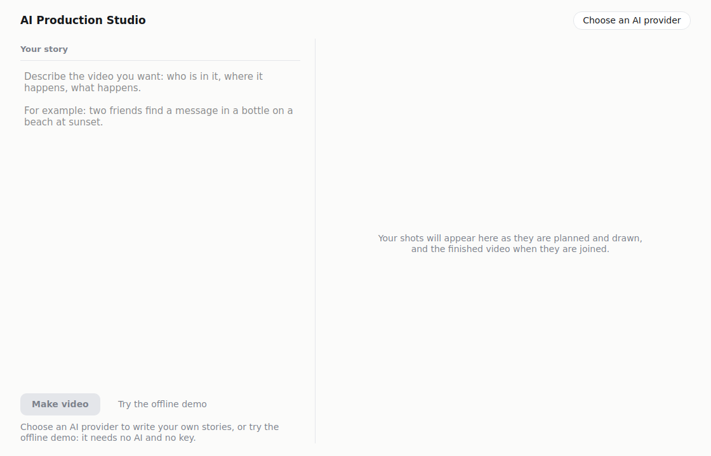
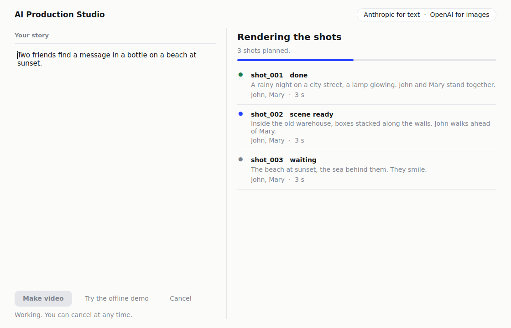

# Tutorial 8: Blaze Studio

Blaze turns a screenplay you write into a video. **Blaze Studio** is the other way in: a desktop window where you describe a
video in a few sentences and the studio plans the shots, draws the characters, sets up each scene, renders it and joins the shots
into one video. It has two modes: an **offline demo** that needs nothing, and **your own story** that uses an AI provider you
choose.

## Open it

- **Installed on Windows:** the Start menu has **Blaze Studio** next to **Blaze** ([the installer](../installer.md)).
- **From source:** `cd studio` then `python main.py` (needs `pip install -r studio/requirements.txt`).

The first time, a small window asks you to choose an AI provider and paste your own key. You can press **Cancel**: the studio still
opens, and the offline demo works. Change the provider later with the chip at the top right.

## Try the offline demo

Press **Try the offline demo**. No AI, no account and no key are used:

1. the studio takes its built-in three-shot story (John and Mary on a rainy street, in a warehouse, on a beach at sunset; it
   ignores whatever you typed, which is what a demo is);
2. it draws John and Mary with Blaze's own art code, one look per description, the same every time;
3. it sets up each scene, choosing a backdrop from the words in the shot (a rainy night street, a dim warehouse, a sunset beach);
4. CDRCA renders the frames and ffmpeg joins them.

The right side shows each shot with its state as it moves from waiting, to scene ready, to done. On a one-core test machine with no
graphics card the demo takes about 20 seconds. When it finishes you get a still from the video, its length and size, and three
buttons:

| Button | What it does |
|---|---|
| **Play** | opens the video in your default player |
| **Show in folder** | opens the folder that holds it |
| **Save a copy…** | copies it where you choose |

## Make your own video

You need a provider chosen first (the chip says which). Then:

1. Write what the video is about in **Your story**: who is in it, where it happens, what happens. One to a few sentences is enough.
2. Press **Make video** (or Ctrl+Enter).
3. Watch the steps: *Planning the shots*, *Drawing the characters*, *Setting up the scenes*, *Rendering the shots*,
   *Joining the shots into one video*. **Cancel** stops after the step that is running.

What happens behind it: your text goes to the text provider you chose, which returns a plan (the shots and the characters, with a
look for each). Each character's picture comes from the image provider you chose (so Anthropic for text needs Gemini or OpenAI
for images). The scenes are built and rendered as in the demo.

If something goes wrong the window says so in a plain sentence, and **Back to your story** returns to what you wrote, which is
always kept. The usual ones:

| You see | What to do |
|---|---|
| *Choose an AI provider first (…)* | press the chip at the top right and choose one |
| *The AI's shot plan could not be used: …* | the AI's answer was not a usable plan; try again, or reword the story |
| *Some steps failed: shot_002 (render): …* | the message names the shot and the step; the renderer needs Node.js and its browser (they are included in the installer) |

## Where the files are

Installed: `%APPDATA%\Blaze\Studio\storage\output` for your videos, `%APPDATA%\Blaze\Studio\config.yaml` for your settings (it starts
with every key empty), and the demo's files in `...\storage\demo`. From source: the `storage` folder in `studio/`, or the
`storage_path` in `studio/config.yaml`.

## What it does not do (yet)

- **No voices or subtitles.** The studio makes silent videos. For spoken dialogue, speech boxes and subtitles use Blaze with a
  screenplay ([Tutorial 2](02-writing-a-screenplay.md)); it is also the way to control every line and position exactly.
- Characters stand side by side in each shot; words in the shot's action decide whether they walk a little or nod while they talk.
- Backdrops are chosen by looking for place and mood words in the AI's description (street, room, warehouse, forest, beach,
  office; day, sunset, night, rain, snow...). A shot that mentions none gets a street by day.
- **Your own story has been tested only with scripted stand-ins for the AI**, never against a live provider. The offline demo is
  tested for real, through the window, end to end.
- The Godot renderer (`render_backend: godot` in `config.yaml`) is not part of the Blaze installer and has not been verified.

## Blaze or Blaze Studio?

| You want | Use |
|---|---|
| exact control: every line, voice, position, subtitles | **Blaze** (a screenplay) |
| to describe a video loosely and let the studio decide the shots | **Blaze Studio** |
| something that works with no AI at all | either: Blaze always does, the studio has the offline demo |
